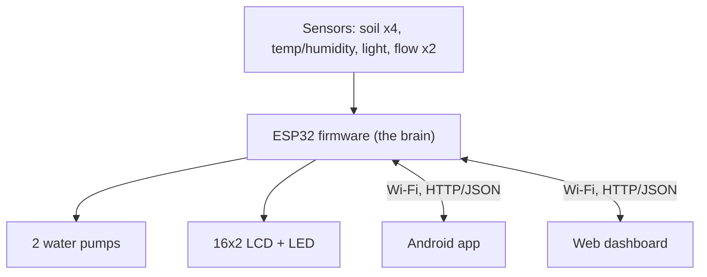
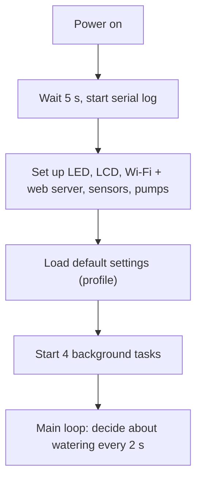
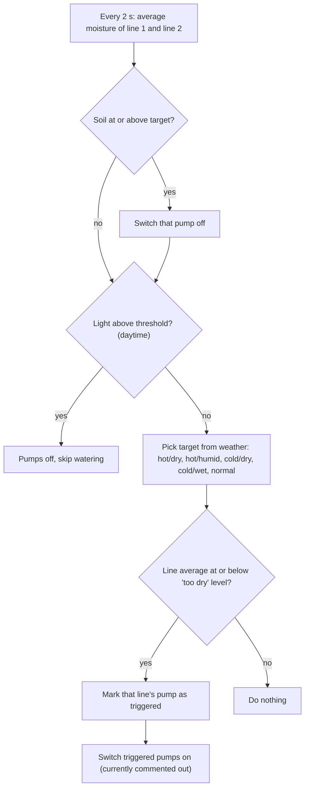
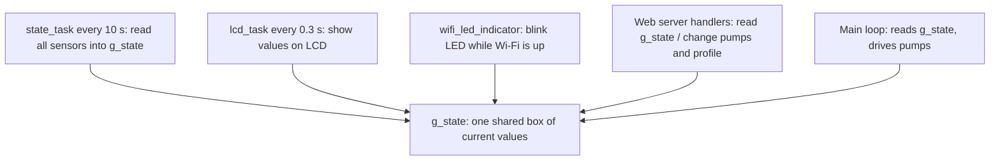
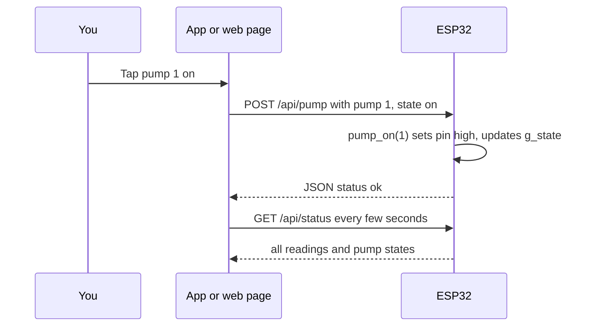

# Smart plant watering: explainer

*Generated 2026-10-27. Read top to bottom: the big picture comes first, the details after.*

## 1. What this is

A graduation project: a small **automatic plant-watering system**. A box built around an **ESP32** (a cheap Wi-Fi-enabled microcontroller, i.e. a tiny computer on one chip) reads soil moisture, temperature, humidity, light and water flow, and decides when to switch two water pumps on. The ESP32 makes its own Wi-Fi network, so a **phone app** (Android, Java) and a **web dashboard** (Next.js, a React-based website framework) can connect straight to it to show readings, press pump buttons and change settings. There is also a custom circuit board design (KiCad) and a pile of datasheets. State: the firmware, web app and Android app all exist and talk to each other; it looks like a work in progress. In the current working copy the automatic pump switching is commented out in `embedded/src/main.c` (an uncommitted edit of yours), so only the manual buttons turn pumps on.

## 2. The big picture

The ESP32 is the centre of everything. It **creates its own Wi-Fi network** (name `ESP32_AP`, address `192.168.4.1`), so there is no router or internet needed. It runs a tiny web server. The phone app and the web page are just two "remote controls" that send requests to that server: "give me the readings", "turn pump 1 on", "here are new settings". No cloud, no database: all state lives in the ESP32's memory.

## 3. How it works, step by step

### 3a. Starting up

On boot, `app_main` in `embedded/src/main.c` initialises each part in turn, blinks the LED, shows "BOOTED!" on the LCD, then runs forever. Settings are **not saved**: after a reboot they go back to the defaults in `init_states`.

### 3b. The watering decision (main loop)

Plain words: the four soil sensors are paired into two "lines" (sensors 1+2 and 3+4), each line with its own pump. Watering never happens in daylight. At night, if a line is drier than `moist_lower`, its pump is flagged. The target moisture it waters up to is `moist_upper`, nudged up when it is hot and dry (+20) or hot and humid (+8) and down when it is cold (-5 dry, -15 wet). Once the line reaches the target the pump is switched off.

### 3c. Background tasks (always running)

`g_state` (defined in `embedded/include/esp_idf_common.h`) is the shared notebook everybody reads and writes. Each task is a **FreeRTOS task** (FreeRTOS is the small operating system on the ESP32; a task is a function that runs in parallel with others). `irrigation_task` exists but is an empty placeholder.

### 3d. Pressing "Pump on" in the app or web page

The same `/api/status` poll feeds the dashboards (web polls every 3 s). Flow sensors then confirm water is really moving: `read_tank` flags an empty tank if both pumps run but no flow shows, and `read_pipe` flags a blocked or leaking pipe if only one of the two flows.

## 4. Where each feature lives in the code

| Feature | What it does (plain words) | Where | Key functions/classes |
|---|---|---|---|
| Boot and watering logic | Sets everything up, decides when to water based on moisture, weather and daylight | `embedded/src/main.c` | `app_main`, `irrig_amount`, `OFFSET_*` constants |
| Shared state and defaults | One struct holding every reading, pump state and the settings profile | `embedded/include/esp_idf_common.h`, `embedded/src/esp_idf_common.c` | `status_t`, `profile_t`, `g_state`, `init_states`, `delay_ms`, `init_adc1_shared` |
| Background tasks | Sensor reading, LCD refresh, Wi-Fi LED | `embedded/src/tasks.c` | `init_tasks`, `state_task`, `lcd_task`, `wifi_led_indicator`, `irrigation_task` (empty) |
| Soil moisture | Reads 4 probes, median of 5 samples, converts to 0-100 % | `embedded/src/moisture_sensor.c` | `init_moisture`, `read_moisture`, `read_median` |
| Light sensor (LDR) | Reads brightness as 0-100 % | `embedded/src/ldr_sensor.c` | `init_ldr`, `read_ldr` |
| Temperature and humidity | Reads the DHT sensor (library in `components/dht-1.2.0`) | `embedded/src/t_h_sensor.c` | `read_th` |
| Water flow | Counts pulses from 2 flow sensors, converts to litres/min | `embedded/src/flow_sensor.c` | `init_flow_sensors`, `read_flow_sens`, interrupt handlers `isr_sensor1/2` |
| Pumps | Switch the two pumps on/off through GPIO pins | `embedded/src/pump.c` | `init_pumps`, `pump_on`, `pump_off` |
| Tank and pipe checks | Infers "tank empty" and "pipe problem" from flow readings | `embedded/src/tank.c`, `embedded/src/pipe.c` | `read_tank`, `read_pipe` |
| LCD 16x2 | Writes readings to the screen (4-bit mode) | `embedded/src/lcd.c` | `init_lcd`, `lcd_write_string`, `lcd_set_cursor`, `lcd_clear` |
| Status LED | Blink patterns (boot, Wi-Fi, names) | `embedded/src/led.c` | `led_on/off`, `blink_5`, `blink_wifi` |
| Wi-Fi access point + HTTP API | Makes the `ESP32_AP` network and serves JSON | `embedded/src/networking.c` | `init_networking`, `start_webserver`, `status_handler`, `pump_handler`, `led_handler`, `profile_get_handler`, `profile_post_handler` |
| Serial log, console input, button | Debug output over USB, typed input, a button that lights the LED | `embedded/src/uart.c`, `serial_input.c`, `button.c` | `init_monitoring_uart`, `get_serial_input`, `on_press` (not called from main) |
| Web: connection to ESP32 | All requests to the device, plus a "connected?" ping | `web/lib/espApi.jsx`, `web/lib/useEspConnection.jsx` | `getSensors`, `setPump`, `setLed`, `createProfile`, `useEspConnection` |
| Web: dashboard | Live readings, refreshed every 3 s | `web/app/dashboard/page.jsx` | `fetchSensorData` |
| Web: manual control | Pump on/off buttons | `web/app/manual/page.jsx` | `pumpOn`, `pumpOff` |
| Web: plant profiles | Create/edit profiles (stored in the browser), send the active one to the ESP32 | `web/app/plants/page.jsx` | `saveProfiles`, `sendPlantProfile` |
| Web: layout and menus | Page frame, side menu, dark/light theme; `/` redirects to the dashboard | `web/app/layout.jsx`, `web/app/page.jsx`, `web/components/` | `Sidebar`, `MobileNav`, `ThemeScript` |
| Android: connection | Describes the API and the device address | `mobile/app/src/main/java/com/example/firstcourse/data/remote/` | `ApiService`, `RetrofitClient` |
| Android: data layer | Calls the API, wraps results; mock-data switch (off) | `.../data/repository/DeviceRepository.java`, `.../data/mock/MockData.java`, `.../data/model/` | `DeviceRepository`, `USE_MOCK_DATA`, `DeviceStatus`, `IrrigationProfile` |
| Android: screens | Dashboard, pump controls, LED, profiles | `.../MainActivity.java`, `ControlsActivity.java`, `LedControlActivity.java`, `ProfileActivity.java`, `.../ui/*` | `MainActivity`, `DashboardViewModel`, `ControlsViewModel`, `AnimatedDashboardView`, `ProfileAdapter` |
| Circuit board | Custom ESP32 board design | `pcb/ESP32_Board.kicad_*`, `pcb/ESP32_Board.pdf` | (KiCad files) |

## 5. Folder tour

| Folder | What lives there |
|---|---|
| `embedded/` | ESP32 firmware in C (PlatformIO + ESP-IDF). `src/` code, `include/` headers. Ignore `components/dht-1.2.0` and `managed_components/` (third-party libraries), `sdkconfig.esp32dev` (generated config) |
| `web/` | Next.js dashboard. `app/` pages, `lib/` talks to ESP32, `components/` menus. Ignore `public/*.svg`, `package-lock.json` |
| `mobile/` | Android Studio project (Java). Real code is in `app/src/main/java/com/example/firstcourse/`. Ignore `gradle/`, `gradlew*`, `res/drawable` icons. `new.sh`, `new2.sh` are small git helper scripts, not app code |
| `pcb/` | KiCad circuit board design; `.history/` is KiCad's own backup (and has a nested git repo inside) |
| `datasheets/` | Part datasheets (ESP32, LCD, LM2596, TP4056, MOSFETs, flow sensor) and screenshots |
| `c-prototype/` | Early test: a plain C program with an old "profile" idea (times per day, water amount). Not used by anything else |

## 6. Data and settings

- **On the ESP32:** everything is in RAM (`g_state`). The settings "profile" (defaults: moist_upper 80, moist_lower 20, temp_upper 40, temp_lower 5, hum_upper 60, hum_lower 20, light_threshold 85) is lost on reboot. NVS (the ESP32's small saved-settings area) is initialised in `main.c` but nothing is stored in it.
- **Web:** profiles are saved in the browser's `localStorage` under `plantThresholdProfiles` and `activePlantThresholdProfile`.
- **Android:** profiles go through the API; mock data exists in `MockData.java` but is switched off.
- **Config files:** `embedded/platformio.ini` (board and build), `embedded/sdkconfig.esp32dev`, Wi-Fi name and password are `#define`d in `embedded/include/networking.h` (a hard-coded password sits in the tracked source), device address `192.168.4.1` in `web/lib/espApi.jsx`, `web/lib/useEspConnection.jsx` and `.../data/remote/RetrofitClient.java`.
- **Pins** (from the headers): pumps 17/16, flow 22/23, DHT 18, LED 2, LDR 39, moisture power 14, LCD 13/27/26/25/21/19. Note the button pin (21) is the same as an LCD pin (D6), and two pins are marked `// PROBLEM` in the source.

## 7. How to run it

- **Firmware:** from `embedded/`, `pio run -t upload` then `pio device monitor` (PlatformIO, 115200 baud). `[reconstructed from code shape only]` the commands come from `platformio.ini`, not from a doc.
- **Web:** from `web/`, `npm install` then `npm run dev`, open http://localhost:3000. Your computer must be on the `ESP32_AP` Wi-Fi to see data.
- **Android:** open `mobile/` in Android Studio and run on a phone joined to `ESP32_AP`. (Plain HTTP; `AndroidManifest.xml` cleartext setting not verified.)

## 8. Glossary

- **ESP32**: a Wi-Fi-capable microcontroller (tiny single-chip computer).
- **Firmware**: the program that runs on the ESP32.
- **ESP-IDF / PlatformIO**: the official ESP32 toolkit, and the build/upload tool that wraps it.
- **FreeRTOS task**: a function running "in parallel" with others on the ESP32.
- **GPIO pin**: a metal leg on the chip you can switch on/off or read.
- **ADC**: converts a voltage (like a soil probe signal) to a number.
- **Interrupt (ISR)**: code that runs instantly when a pin changes, used to count flow-sensor pulses.
- **SoftAP**: the ESP32 acting as the Wi-Fi hotspot itself.
- **HTTP / JSON / API**: the way apps ask the ESP32 for data: web requests with small text replies; the list of allowed requests is the API (`/api/status`, `/api/pump`, `/api/led`, `/api/profile`).
- **Profile**: the set of thresholds (moisture, temperature, humidity, light) that steer watering.
- **LDR**: a light-dependent resistor, a light sensor.
- **DHT**: a combined temperature and humidity sensor.
- **LCD**: the small text display.
- **Next.js / React**: website tools used for the dashboard.
- **Retrofit / Gson**: Android libraries for web requests and reading JSON.
- **ViewModel / LiveData**: Android pieces that hold screen data and update the screen when it changes.
- **KiCad**: free software for designing circuit boards.
- **localStorage**: small storage inside the browser.

## Known mismatches worth checking

- The web app sends profiles with keys like `moistureThreshold`, the Android app sends `moisture_threshold`, but the firmware only reads `moist_upper`, `moist_lower`, `temp_upper`, `temp_lower`, `hum_upper`, `hum_lower`, `light_threshold`. As written, profile changes from either app do not seem to change anything on the device. Not tested on hardware.
- `DELETE /api/profile` is called by the apps, but the firmware has no such route.
- Fresh sensor values arrive only every 10 s, while the main loop runs every 2 s.
